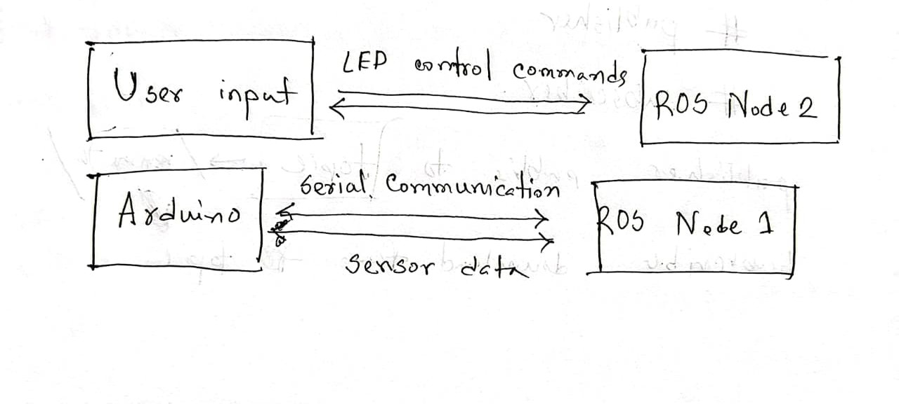

# MT12 – Controls & Software Assignment

## C1: 

### 1



The system uses two ROS 2 nodes to communicate between the Arduino and the user interface.

- Node 1 handles sensor data while Node 2 manages the user interface if one crashes other stay active. 
- Each Node can be developed and tested independently.

### 2. 

```text
A:25,B:0.75,C:512,D:Hello
```
- i would choose a commas (`,`) separated format.
- when it sees commas (`,`) it will no the end of one value and another begin.
- by using a Serial Node that reads the message, separates the fields, and checks whether the received values are valid before publishing them.
- so that the arduino and ROS 2 node interpret the transmitted information consitently and reduces error.

### 3.

**a.** User interface Node: Publisher and Serial Node: Subscriber.

**b.** The serial node should publish the sensor value because it receives the information directly from arduino. 

**c.** 
- Topic: communication channel used by ROS 2 Nodes.
- Publisher: ROS 2 Node that send message to the topic.
- Subscriber: ROS 2 Node that recevies message from the topic. 

**d.**
- user -> ros2 node2 -> /led_command -> ros2 node1 -> Arduino LED 

**e.** 
- processing delays increases.
- messages gets dropped when the queue limits exceeded. 
- old message gets processed rather than the new messages.

---

## C2: 

An EMA filter can smooth the readings by combining the current raw value with the previous filtered value.

For this implementation, the value of alpha is 0.2.

A smaller alpha gives more importance to previous reading.

The function calculates and returns the filtered value:

```cpp
double noiseCancellation(double rawValue, double previousValue)
{
    const double alpha = 0.2;

    double rawValue =
        alpha * rawValue +
        (1.0 - alpha) * previousValue;

    return rawValue;
}
```

---

## C3: 

Inverse Kinematics (IK) calculates the required joint angles of a robotic arm to reach a given Cartesian position.

The robotic arm has two segments:

- Segment 1: 14 cm
- Segment 2: 15.5 cm

The target position is received through the ROS 2 topic:

`/miniarm/target`

Message type: `geometry_msgs/msg/Vector3`

The calculated joint angles are published through:

`/miniarm/angles`

Message type: `geometry_msgs/msg/Vector3`

The output vector contains:

- `x`: Joint 1 angle
- `y`: Joint 2 angle
- `z`: 0.0

